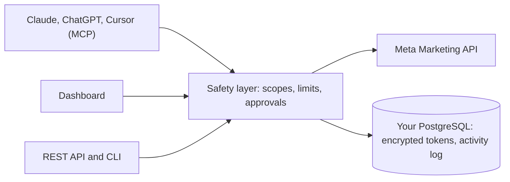

<p align="center">
  
</p>

<h1 align="center">Meta Ads MCP</h1>

<p align="center"><strong>Open-source Meta (Facebook &amp; Instagram) Ads manager with an MCP server.</strong><br>
Let Claude, ChatGPT or Cursor manage your ads, safely: nothing changes outside the limits you set.</p>

<p align="center"><sub>by <a href="https://ads.viral4all.com">Viral4All Ads</a> · self-hosted edition</sub></p>

<p align="center">
  <a href="LICENSE"></a>
  
  
  
  <a href="CONTRIBUTING.md"></a>
</p>

<p align="center">
  <a href="https://ads.viral4all.com">Hosted version</a> ·
  <a href="#quick-start">Quick start</a> ·
  <a href="docs/ADDING_A_PLATFORM.md">Add a platform</a> ·
  <a href="https://ads.viral4all.com/docs">Docs</a> ·
  <a href="https://github.com/black12-ag/meta-ads-mcp/issues">Issues</a> ·
  <a href="SECURITY.md">Security</a>
</p>

Connect a Meta account, then manage your ads from a dashboard, from an AI assistant (Claude, ChatGPT,
Cursor) or from a script.

**How the safety works:** every change an AI or API key asks for is checked against limits you set
(highest daily budget, biggest raise, changes per day, protected campaigns). Anything above them waits
on an approval page until you confirm it. Pausing an ad, which only stops spend, runs straight away.

**Don't want to host it?** Use the [hosted version](https://ads.viral4all.com). This repository is the
self-hosted edition: you run the server, the database and your own Meta app.

## Contents

[Features](#features) · [How it works](#how-it-works) · [Platforms](#platforms) ·
[Quick start](#quick-start) · [MCP tools](#mcp-tools) · [REST API and CLI](#rest-api-and-cli) ·
[Project layout](#project-layout) · [FAQ](#faq) · [Contributing](#contributing) ·
[License](#license-and-copyright)

## Features

|                          |                                                                                                                                                                |
| ------------------------ | -------------------------------------------------------------------------------------------------------------------------------------------------------------- |
| **Dashboard**            | Campaigns, ad sets, ads, results and analytics, a saved-ads library, and a guided way to create a campaign                                                     |
| **MCP server**           | `/mcp` with OAuth sign-in and per-tool scopes. Works with Claude, ChatGPT, Cursor, Claude Code, Codex and any other MCP client                                 |
| **Limits and approvals** | You set the limits. Anything above them waits for your approval link. The server enforces this, not the AI                                                     |
| **Activity log**         | Every read and change is recorded, with who made it: you, an API key or an AI app                                                                              |
| **REST API and CLI**     | The same tools over plain HTTP with scoped API keys, and a command-line client                                                                                 |
| **Alerts and webhooks**  | A daily account check that emails you when something needs attention (for example, the monthly budget is used up), and webhooks you can send to your own tools |
| **Several accounts**     | Link more than one Meta login and switch between ad accounts                                                                                                   |

## How it works



Everything goes through the safety layer. An AI app only sees the tools its key or sign-in allows,
reads run straight away, and changes that raise spend or change what people see wait for you.

## Platforms

Meta is the only platform that works today. The others are planned, and **you can build one**: see
[docs/ADDING_A_PLATFORM.md](docs/ADDING_A_PLATFORM.md).

| Platform                                                                                                  | Status   | What it covers                                                                |
| --------------------------------------------------------------------------------------------------------- | -------- | ----------------------------------------------------------------------------- |
|                     | **Live** | Facebook and Instagram campaigns, ad sets, ads, results, creatives, audiences |
|               | Planned  | Short-form organic and Spark Ads                                              |
|  | Planned  | Search, Performance Max and YouTube spend                                     |
|         | Planned  | Company page posts and sponsored content                                      |
|                              | Planned  | Posts, replies and promoted content                                           |

Want one of these sooner? Open an issue, or send a pull request.

## What you need

|                                       |                                                                                     |
| ------------------------------------- | ----------------------------------------------------------------------------------- |
| Node 22.9 or newer and PostgreSQL 13+ | to run it                                                                           |
| A public HTTPS address                | Meta only redirects back to HTTPS addresses (localhost is allowed while developing) |
| A Firebase project                    | for sign-in only; the free plan is enough                                           |
| A Meta app                            | your own, from https://developers.facebook.com                                      |
| Resend account (optional)             | for email alerts                                                                    |
| Cloudflare Turnstile (optional)       | "I'm not a robot" on the sign-in page                                               |

## Quick start

One command does the setup. It installs the packages, makes your secret keys, creates the database,
writes `.env.local` and offers to start the app.

```sh
git clone https://github.com/black12-ag/meta-ads-mcp.git && cd meta-ads-mcp
npm run setup
```

It asks for a few things. Press **Enter** to skip any you don't have yet; you can fill them in
later in `.env.local`, and running `npm run setup` again keeps what you already entered:

| It asks for            | Where to get it                                                                  |
| ---------------------- | -------------------------------------------------------------------------------- |
| Public address         | `http://localhost:3000` on your computer, or your `https://` address on a server |
| PostgreSQL address     | Your database. The database itself is created for you                            |
| Firebase values (4)    | [Firebase](#firebase-sign-in), 5 minutes                                         |
| Meta App ID and Secret | [Meta app](#meta-app), 10 minutes                                                |

It makes these for you, so you never have to invent them: `TOKEN_ENCRYPTION_KEY` (encrypts the stored
Meta tokens; **keep it safe**, because losing it makes them unreadable), `CREATIVE_URL_SECRET`,
`META_WEBHOOK_VERIFY_TOKEN` and `META_SYNC_CRON_SECRET`.

At the end it prints the two addresses to enter in your Meta app. Then open the app, sign up, and
connect Meta.

`.env.local` is git-ignored. Never commit it. After that, `npm run dev` starts the app any time.

<details>
<summary>Prefer to do it by hand?</summary>

```sh
npm install
createdb viral4all_ads
cp .env.example .env.local     # fill it in
openssl rand -hex 32           # TOKEN_ENCRYPTION_KEY
openssl rand -hex 24           # CREATIVE_URL_SECRET, META_WEBHOOK_VERIFY_TOKEN, META_SYNC_CRON_SECRET (one each)
npm run db:migrate
npm run dev
```

</details>

### Firebase (sign-in)

1. Create a project at https://console.firebase.google.com.
2. Authentication → Sign-in method → turn on **Email/Password** and **Google**.
3. Authentication → Settings → Authorized domains → add your domain.
4. Project settings → add a **Web app** and copy its config into `VITE_FIREBASE_API_KEY`,
   `VITE_FIREBASE_AUTH_DOMAIN`, `VITE_FIREBASE_PROJECT_ID`, `VITE_FIREBASE_APP_ID`.
5. Set `FIREBASE_PROJECT_ID` to the same project id. The server checks sign-in tokens itself, so you
   don't need a service-account file.

### Meta app

1. https://developers.facebook.com → **Create app** → use case **Create & manage ads with Marketing
   API**.
2. Add **Facebook Login** (or Facebook Login for Business) and set the **Valid OAuth Redirect URI**
   to `https://YOUR-DOMAIN/api/public/meta/callback`.
3. Settings → Basic: copy the App ID and App Secret into `META_APP_ID` and `META_APP_SECRET`. Add a
   privacy policy URL (`https://YOUR-DOMAIN/privacy`) and a data deletion URL
   (`https://YOUR-DOMAIN/api/public/meta/data-deletion`).
4. The app asks for these permissions: `ads_management`, `ads_read`, `pages_show_list`,
   `pages_read_engagement`, `pages_manage_ads`, `business_management`.
5. `PUBLIC_BASE_URL` must be that same address (the setup script asks for it).

**Development mode.** A new Meta app starts in development mode. In that mode only people with a role
on the app (you, plus testers you add under **App roles**) can connect, and reading and managing
existing ads works. Meta refuses to create new ad creatives until the app is switched to **Live**.
To manage ad accounts that belong to other people you also need Meta's App Review and business
verification. Meta changes these rules, so check their current documentation before you promise
anything to your users.

### Run it for real

```sh
npm run build
npm start                       # port 3000; set PORT (and HOST) to change it
```

Put it behind an HTTPS reverse proxy (nginx, Caddy). `npm start` reads `.env.local` too. Under
systemd or Docker, put the same variables in the service's environment instead.

Meta data is synced by a scheduler you set up. Every 30 minutes, call:

```sh
curl -X POST https://YOUR-DOMAIN/api/public/meta/sync -H "x-cron-secret: $META_SYNC_CRON_SECRET"
```

### Connect an AI

Open **Connect AI** in the dashboard. It shows your MCP address, `https://YOUR-DOMAIN/mcp`. Add it to
Claude, ChatGPT or Cursor as a custom connector and sign in when asked.

## MCP tools

An AI app only sees the tools its sign-in or API key allows (each tool needs a scope, for example
`ads:read`).

| Kind                                 | Tools                                                                                                                                                                                                                      |
| ------------------------------------ | -------------------------------------------------------------------------------------------------------------------------------------------------------------------------------------------------------------------------- |
| **Read** (run straight away)         | `meta_list_ads`, `meta_list_campaigns`, `meta_get_insights`, `meta_list_accounts`, `meta_search_targeting`, `meta_list_audiences`, `meta_activity_log`, `meta_connection_status`                                           |
| **Safe changes** (run straight away) | `meta_pause_ads` (only stops spend), `meta_create_ad` and `meta_duplicate` (always create a **paused** copy), `meta_upload_media`, `meta_sync_now`, `meta_switch_account`                                                  |
| **Need your approval**               | `meta_resume_ads`, `meta_set_budget`, `meta_update_creative`, `meta_update_adset`, `meta_archive`. They return an approval link; the change runs only when you press Approve. `meta_confirm_action` then reads the outcome |

Your limits (highest daily budget, biggest raise, changes per day, protected campaigns) are checked
by the server on every request. "Blocked by your limits" means the AI must stop and ask you.

## REST API and CLI

Create an API key in the dashboard (**API keys**), choose its scopes, and call any tool over HTTP:

```sh
curl -X POST https://YOUR-DOMAIN/api/public/v1/tools/meta_list_campaigns \
  -H "Authorization: Bearer sk_meta_..." \
  -H "Content-Type: application/json" -d '{}'
```

The OpenAPI description is at `/api/public/v1/openapi.json`. The same tools are in the command-line
client in [`cli/`](cli/README.md). Point it at your server with `--server https://YOUR-DOMAIN` or
`VIRAL4ALL_SERVER`, and use `VIRAL4ALL_API_KEY` for the key.

## Project layout

```text
src/routes/       pages and API endpoints (TanStack Start file routes)
src/components/   the interface
src/lib/meta/     Meta Graph API client, sync and ad actions
src/lib/mcp/      the MCP server, its tools, limits and approvals
src/lib/db/       database access and token encryption
src/lib/auth/     sign-in checks
db/schema.sql     the whole database schema (safe to re-run)
cli/              the command-line client
integrations/     Claude and OpenAI plugin files
tests/            the test suite
scripts/          setup.mjs and build helpers
docs/             guides, such as adding a platform
```

Built with TanStack Start (React 19), Tailwind and shadcn/ui, PostgreSQL and the official MCP SDK.

## Commands

| Command                           | What it does                                               |
| --------------------------------- | ---------------------------------------------------------- |
| `npm run setup`                   | Does the whole setup in one go (safe to run again)         |
| `npm run dev`                     | Development server                                         |
| `npm test`                        | Test suite (needs a local PostgreSQL)                      |
| `npm run db:migrate`              | Applies `db/schema.sql` to `$DATABASE_URL`; safe to re-run |
| `npm run build` / `npm start`     | Production build / run it                                  |
| `npm run lint` / `npm run format` | ESLint / Prettier                                          |
| `npm run check:secrets`           | Fails if a server secret can reach client code             |

## FAQ

**Is it really free?** Yes. The code is open source (AGPL-3.0). You pay for your own server and your
own ad spend to Meta.

**Do I need Meta's App Review?** Not to try it on your own ad accounts in development mode, where you
can read and manage existing ads. To create new ads the app must be Live, and to manage other
people's ad accounts you need App Review and business verification. See [Meta app](#meta-app).

**Can the AI overspend?** The server checks your limits on every request, whatever the AI says. A
change above them is refused, and anything that raises spend waits for your approval.

**Where is my data?** In your own PostgreSQL database on your own server. Meta tokens are encrypted
with your key. The app talks to Meta and Firebase (sign-in), and to Resend and Cloudflare Turnstile
only if you turn them on.

**Which AI apps work?** Any app that supports MCP: Claude, ChatGPT, Cursor, Claude Code, Codex, Gemini
CLI and more.

**Can I add TikTok, Google Ads or another platform?** Yes. See
[docs/ADDING_A_PLATFORM.md](docs/ADDING_A_PLATFORM.md).

## Security

- Meta tokens are encrypted at rest with `TOKEN_ENCRYPTION_KEY`. Losing the key makes them unreadable.
- Server secrets never reach the browser (`npm run check:secrets` checks this).
- Found a vulnerability? Please report it privately. See [SECURITY.md](SECURITY.md).

## Contributing

Bug reports and pull requests are welcome. Read [CONTRIBUTING.md](CONTRIBUTING.md) first, and please
follow the [code of conduct](CODE_OF_CONDUCT.md). Adding a platform? Start with
[docs/ADDING_A_PLATFORM.md](docs/ADDING_A_PLATFORM.md). There is no support promise: use
[GitHub issues](https://github.com/black12-ag/meta-ads-mcp/issues) for bugs.

## Support the project

The best way to support it is to use the [hosted version](https://ads.viral4all.com), or tell someone
who runs Meta ads. The **Sponsor** button on this repository links there too.

## Community and contact

- WhatsApp: https://wa.me/message/XAPGDNH6M4HGB1
- Telegram: https://t.me/ethioviral_support
- Facebook: https://www.facebook.com/share/1FUDUaq4z3/
- Instagram: https://www.instagram.com/munir.kab
- TikTok: https://www.tiktok.com/@ethio_viral4
- X: https://x.com/muay01111
- Email: support@viral4all.com

## License and copyright

Copyright (C) 2026 Viral4All Ads authors

This program is free software: you can redistribute it and/or modify it under the terms of the
[GNU Affero General Public License](LICENSE) version 3. It comes with no warranty. If you run a
modified version as a service for other people, you must share your changes under the same license.

The code is free to use and fork. The **Viral4All** name and logo belong to the project: if you
publish a fork or run a public service, please use your own name and logo.

Hosted-only extras of the service at ads.viral4all.com are not part of this repository.
